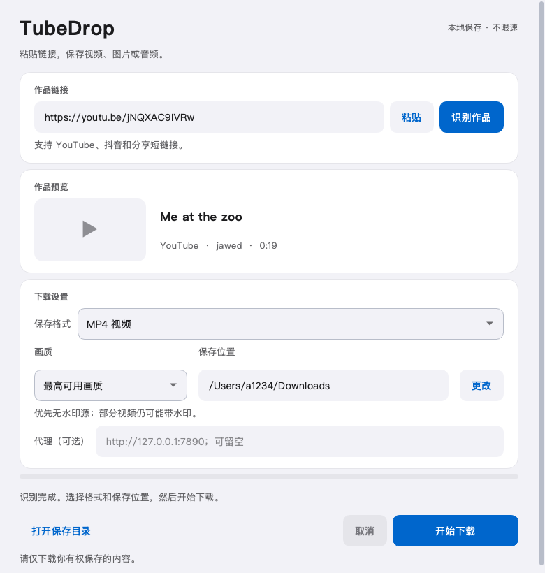

# TubeDrop 2.0.0

简约 iOS 风格的 YouTube / 抖音 桌面下载工具。粘贴链接，自动识别视频或抖音图文，选择格式和目录后保存。视频支持 MP4，音频支持 MP3 / FLAC，抖音图片支持原格式 / JPG / PNG / WebP。视频下载不设置速度上限或人为等待。

2.0.0 已按要求移除 TikTok 链接识别和下载；完整链接、分享短链接和分享文案均会拒绝。升级不影响已下载文件和保存目录。

## 安装和使用

前往 [v2.0.0 下载页面](https://github.com/HelloRyj/TubeDrop/releases/tag/v2.0.0) 获取安装包，或直接选择：

- [macOS Apple Silicon 安装包](https://github.com/HelloRyj/TubeDrop/releases/download/v2.0.0/TubeDrop-2.0.0-macOS-arm64.pkg)
- [Windows x64 安装包](https://github.com/HelloRyj/TubeDrop/releases/download/v2.0.0/TubeDrop-2.0.0-Windows-x64-Setup.exe)
- [SHA256 校验文件](https://github.com/HelloRyj/TubeDrop/releases/download/v2.0.0/TubeDrop-2.0.0-SHA256.txt)

Release 中自动生成的 Source code 压缩包用于开发，请使用上面的 PKG / EXE 安装程序。

**macOS：**双击 `TubeDrop-2.0.0-macOS-arm64.pkg`，按系统安装器提示安装到“应用程序”，然后打开 TubeDrop。此包针对 Apple Silicon Mac，要求 macOS 14 或更新版本；Intel Mac 需要在 Intel 环境重新构建。

**Windows：**双击 `TubeDrop-2.0.0-Windows-x64-Setup.exe`，按向导安装，完成后从开始菜单打开 TubeDrop。默认安装到当前用户的 `%LOCALAPPDATA%\Programs\TubeDrop`，无需预装 Python、Node 或 FFmpeg。卸载可通过系统“已安装的应用”或开始菜单中的卸载入口完成，用户下载的视频和设置会保留。目标系统为 Windows 10 / 11 x64。

**验证边界：**Mac 包已完成测试、签名校验和安装载荷检查。Windows 安装器已在 Mac 上跨平台编译，运行组件使用官方 Windows 发行包且逐文件校验；当前没有 Windows 电脑，尚未完成 Windows 上的实际启动、下载和卸载验证。Windows 包应先在目标电脑试用。安装包尚未进行 Apple 公证或商业代码签名，外部分发可能出现系统发布者提示。

使用流程：粘贴 YouTube / youtu.be / Shorts / 抖音链接 → 自动识别 → 选择视频、图片或音频格式，以及画质和保存位置 → 开始下载。下载完成后点击“打开保存目录”。取消后可能保留未完成的临时文件；重新下载不会覆盖已有视频。

无法连接视频平台时，可输入自己的 HTTP 或 SOCKS5 代理地址，例如 `http://127.0.0.1:7890`。代理不保存。需要访问权限或人机验证的视频可能无法下载；当前版本不支持直播、播放列表或个人主页批量下载，也不会读取浏览器登录信息。

## 界面预览



[查看下拉菜单预览](docs/menu-preview.png)。菜单采用浅底深字，选中项为蓝底白字，支持鼠标和键盘选择。

## 抖音链接与格式选择

支持 `www.douyin.com/video/视频ID`、带 `modal_id` 的桌面视频链接、`www.iesdouyin.com/share/video/视频ID/` 和 `v.douyin.com` 分享短链接。可以粘贴包含一条链接的分享文案；多个链接会拒绝。短链接逐跳检查，拒绝跳到其他平台、直播或不带作品 ID 的主页。

两个平台的视频作品都可选择 **MP4 视频**、**MP3 音频 · 192 kbps** 或 **FLAC 音频**。MP4 可选画质；音频模式通过 FFmpeg 提取声音，视频画质选择自动禁用。抖音优先提取原视频的声音，避免保存成单独的背景音乐。原视频无音轨时，音频格式会提示不可用；转换不会提高原音频的音质。

抖音原详情接口失败时，1.3.2 会自动改用移动分享页解析。临时游客会话仅保留在下载进程内存中，无需登录、手动验证或导入 Cookie，不读取浏览器信息，也不使用第三方解析服务。已实测公开抖音视频 MP4 / MP3 下载成功；平台仍可能返回空数据或拒绝请求，不能保证所有作品都可下载。

分享页未提供可靠的流分辨率时，仅显示“最高可用画质”，保存平台实际返回的播放流；不将请求的 1080p 当作实际画质，也不承诺 4K。无法解析时可点击识别重试。

## 原始播放源与水印

默认排除明确标记为带水印的格式，以及抖音的下载专用流，再选择画质。抖音分享页的已知官方水印接口会转换到同作品的原始播放接口；已实测 1080 × 1920 MP4，抽帧未见平台水印。过滤后没有播放视频时停止，不改用已知带水印版本或独立背景音乐。

**目前不能保证所有平台、所有作品都无水印。** 程序尚不能自动识别像素中的所有水印，不把“播放流”或“下载成功”视作无水印验证。YouTube 样例抽帧未见平台水印；创作者写入画面的标识、字幕不会被擦除或裁切。

MP3 仅提取原视频声音，不存在画面水印。MP4 / MP3 均保持不限速、无手动访问验证。

## 抖音图片下载

粘贴抖音 `note/作品ID`、`share/note/作品ID`、分享短链接或完整分享文案，识别图文后自动切换图片格式，并显示图片数量。一次保存全部图片，按 `001`、`002` 顺序放入独立目录；重复下载不覆盖已有文件。

| 格式 | 保存方式 |
| --- | --- |
| 原格式（默认） | 保留平台提供的图片字节和格式，不二次压缩 |
| JPG | 高质量有损转换，兼容广；透明区域填白 |
| PNG | 无损编码，保留尺寸和透明通道 |
| WebP | 无损编码，保留尺寸和透明通道 |

只选原图 / 展示图来源，不回退到平台的水印下载图；缺少任何一张可用来源则失败，不静默漏图。作品画面本身的文字、店招或作者标识会保留。实况图本次保存静态图片。原图是平台提供的文件，不等同于创作者上传前的相机原片；转格式不会增加清晰度。

全部图片完成后才显示下载成功；取消时可能保留 `.TubeDrop-` 开头的临时目录。分享页提供配乐地址时可选 MP3 / FLAC，未提供时只显示图片格式；配乐不会冒充视频原音轨。

## FLAC 与源音质

FLAC 模式优先选择平台提供的 FLAC、ALAC 或整数 PCM 无损音轨，保留采样率和声道；原始 FLAC 可直接保存。24 位及 32 位整数 PCM 转 FLAC 已通过逐样本对比。其他未确认的编码不标记为已验证无损源。

**AAC、MP3、Opus 等有损音源转换为 FLAC，不能恢复已经丢失的音质。** 界面会显示源音质提示；仍可选择 FLAC 保存解码后的声音。MP3 为有损编码，目标为 192 kbps。平台是否提供无损源决定能否得到源生无损音频，程序不会通过提高采样率制造“高清音质”。

## 技术和源码运行

Python + PySide6 / Qt Widgets；yt-dlp 解析和下载；Node / EJS 处理 YouTube 脚本；curl_cffi 用于抖音分享页、短链接和图片请求；FFmpeg 合并视频并转换音频；Qt 图像编解码保存和转换图片。Qt 通过 QProcess 启动后台进程，并用 UTF-8 JSON Lines 交换事件。macOS 使用进程组，Windows 使用 Job Object 清理下载子进程。

```bash
python3 -m venv .venv
source .venv/bin/activate
python -m pip install -r requirements-dev.txt
python app.py
python -m pytest tests -q
```

源码运行需要 Python 3.10+、Node.js 22+ 或 Deno 2.3+。Windows 源码环境可使用 `.venv\Scripts\activate`。

## 重建安装包

macOS 构建（对应架构的 Mac）：

```bash
python build.py
```

Windows 安装器可在 Mac、Linux 或 Windows 上编译。先安装 [NSIS / makensis](https://nsis.sourceforge.io/Download)（Mac 可用 `brew install makensis`），然后下载清单锁定的官方 Windows 组件：

```bash
python installer/fetch_windows.py --cache /absolute/path/to/work/windows-cache
python pack_windows.py \
  --cache /absolute/path/to/work/windows-cache \
  --manifest installer/windows-manifest.json \
  --runtimes installer/windows-runtime-manifest.json \
  --payload /absolute/path/to/work/windows-payload
```

Windows 包内置 Python 3.14.8、Node 24.21.0 和 Windows x64 的 PySide6、FFmpeg、yt-dlp 依赖。Qt 发行包附带所需 Visual C++ 运行库。通过 Python 官方嵌入式运行时启动，系统 Python 环境不受影响。`windows-requirements.txt`、两个 JSON 清单记录版本、下载源和校验值。

测试和交付记录见 `VERIFICATION.md`；上游许可见 `THIRD_PARTY.md`。请仅下载你有权保存的内容。
